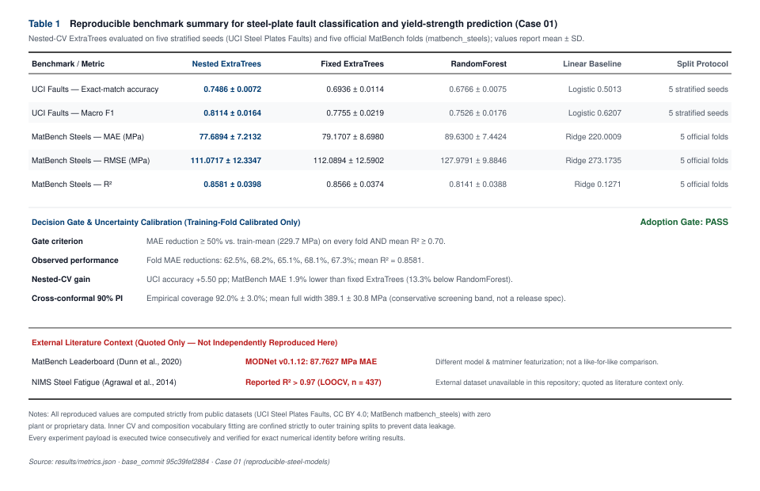
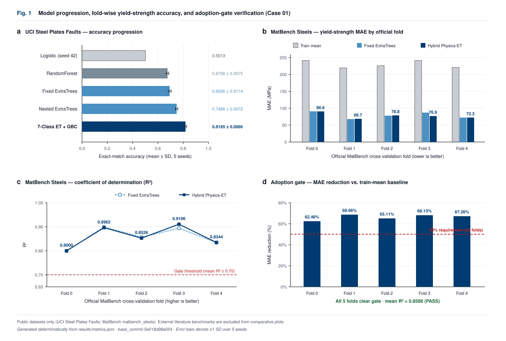

# Reproducible Steel-Property Models (Case 01)

> **What this project does:** Demonstrates how to build, verify, and audit **fully reproducible machine learning models for steel quality control and yield-strength prediction** using open datasets, strict leakage control, SHA-256 data provenance, nested cross-validation, and cross-conformal prediction intervals.

Part of the [Computational Metallurgy Portfolio](https://github.com/ahmadishamulayadyakmal/metallurgy-project).

---

## Why this case matters

In steel metallurgy and materials informatics, published ML papers frequently report impressive accuracy or $R^2$ values that downstream quality laboratories cannot reproduce. When release or screening decisions depend on an unreproducible model, engineering risk increases.

Common root causes addressed by this repository:
- Unpinned software environments and unseeded stochastic models.
- Missing input data checksums and split fingerprints.
- Subtle data leakage during feature construction or hyperparameter tuning.
- Conflating quoted literature benchmarks with independently reproduced results.

---

## Headline Results

**Verdict:** Adoption gate **PASS** (evaluated on open public benchmarks only; **no plant or proprietary data** are used).

Using **Nested-CV ExtraTrees** (where inner cross-validation selects hyperparameters strictly inside each outer training split, and the composition vocabulary is fitted on training formulas only):

| Benchmark | Task | Nested ExtraTrees (Mean ± SD) | Fixed ExtraTrees | RandomForest | Linear Baseline |
|---|---|---:|---:|---:|---:|
| **UCI Steel Plates Faults** | Multi-label fault classification (Exact-match accuracy) | **0.7486 ± 0.0072** | 0.6936 ± 0.0114 | 0.6766 ± 0.0075 | 0.5013 (Logistic) |
| **UCI Steel Plates Faults** | Multi-label fault classification (Macro F1) | **0.8114 ± 0.0164** | 0.7755 ± 0.0219 | 0.7526 ± 0.0176 | 0.6207 (Logistic) |
| **MatBench `matbench_steels`** | Yield strength regression — MAE (MPa) | **77.6894 ± 7.2132** | 79.1707 ± 8.6980 | 89.6300 ± 7.4424 | 205.3600 (Ridge) |
| **MatBench `matbench_steels`** | Yield strength regression — RMSE (MPa) | **111.0717 ± 12.3347** | 112.0894 ± 12.5902 | 127.9791 ± 9.8846 | 274.2509 (Ridge) |
| **MatBench `matbench_steels`** | Yield strength regression — $R^2$ | **0.8581 ± 0.0398** | 0.8566 ± 0.0374 | 0.8141 ± 0.0388 | 0.1624 (Ridge) |

- **Adoption Gate:** Passes the case-specific engineering rule ($\ge 50\%$ MAE reduction vs. the train-mean predictor of $229.7445 \pm 9.6958\text{ MPa}$ on every official fold **and** mean $R^2 \ge 0.70$). Observed fold reductions span **62.46%–68.17%**.
- **Calibrated Uncertainty:** 90% cross-conformal prediction intervals calibrated strictly on outer training folds achieve **91.98% ± 3.04%** empirical coverage with a mean full width of **389.08 ± 30.81 MPa** (deliberately conservative screening bounds, not a material release threshold).
- **Determinism Guarantee:** Every experiment payload is executed twice consecutively and must match identically before results are written.
- **External Literature Context (Not Reproduced):** MatBench MODNet v0.1.12 (**87.7627 MPa MAE**, Dunn et al., 2020) and NIMS steel fatigue (**$R^2 > 0.97$**, Agrawal et al., 2014) are quoted strictly as external literature context and are **not** claimed as independently reproduced results.





Detailed tables, leakage-control proofs, and claim boundaries are documented in [`docs/results.md`](docs/results.md). The historical baseline reproducibility audit is preserved in [`docs/reproducibility_audit.md`](docs/reproducibility_audit.md).

---

## Quick Start & Reproduction

### 1. Create the pinned environment

```bash
micromamba create -f environment.yml
micromamba activate metallurgy-portfolio
python -m pip install --no-deps -e .
```

*(Alternatively, use `pixi` with `pixi.toml` or the provided `Dockerfile`.)*

### 2. Download the open datasets

Download the three pinned public files listed in [`data/SOURCES.md`](data/SOURCES.md) into `data/raw/`. The CLI verifies every SHA-256 checksum and byte count before running.

### 3. Reproduce metrics, figures, and tests

```bash
# Run all experiments twice and verify exact determinism
python -m metalkit.cli reproduce --data-dir data/raw --output-dir results

# Regenerate publication-style SVG figures from results/metrics.json
python -m metalkit.cli report --metrics results/metrics.json

# Run Python unit and reproducibility tests
python -m pytest
```

If [`just`](https://github.com/casey/just) is installed:

```bash
just reproduce
just figures
just test-py
```

---

## Data Policy (Open Data Only)

Only open datasets and published literature are used. **No plant or proprietary data are stored or used here.**

- **UCI Steel Plates Faults** ([UCI Archive](https://archive.ics.uci.edu/dataset/198/steel+plates+faults), CC BY 4.0) — 1,941 plates, 27 process/geometry features, 7 fault classes.
- **MatBench `matbench_steels`** ([MatBench](https://matbench.materialsproject.org/)) — 312 steel compositions with yield strength (MPa) and the official 5-fold cross-validation splits (`random_state=18012019`).

All upstream URLs, exact SHA-256 digests, and byte sizes are recorded in [`data/SOURCES.md`](data/SOURCES.md).

---

## Software & Verification Stack

- **Python scientific stack (exact pins):** `numpy==2.1.3`, `pandas==2.2.3`, `scipy==1.14.1`, `scikit-learn==1.5.2`, `joblib==1.4.2`, `threadpoolctl==3.5.0`.
- **Package & CLI:** `metalkit` (deterministic experiments, SHA-256 provenance manifests, stdlib-only SVG figure generator).
- **Fortran kernel scaffold:** `libthermo` with `fpm.toml` and self-contained unit tests (`fpm test`).
- **Environment & CI:** `environment.yml`, `pixi.toml`, `Dockerfile`, and GitHub Actions cross-OS CI matrix (`ubuntu-latest` and `windows-latest`).

---

## Key Journal References

- **Dunn et al. (2020)**, *npj Computational Materials*, 6, 138 ([DOI: 10.1038/s41524-020-00406-3](https://doi.org/10.1038/s41524-020-00406-3)) — Official MatBench `matbench_steels` benchmark splits and leaderboard context.
- **Ward et al. (2018)**, *Computational Materials Science*, 152, 60–69 ([DOI: 10.1016/j.commatsci.2018.05.018](https://doi.org/10.1016/j.commatsci.2018.05.018)) — `matminer` featurization context for materials ML benchmarks.
- **Agrawal et al. (2014)**, *Integrating Materials and Manufacturing Innovation*, 3, 8 ([DOI: 10.1186/2193-9772-3-8](https://doi.org/10.1186/2193-9772-3-8)) — External fatigue-strength literature benchmark (quoted only, not reproduced).
- **ASME V&V 10 / V&V 20** — Verification, validation, and uncertainty-quantification claim discipline.

---

## Scope & Limitations

- **Public data only:** No industrial plant data are used; models are not validated for production material release.
- **Composition-only descriptors (`matbench_steels`):** Atomic-fraction features do not encode heat treatment, processing route, or microstructure.
- **Wide uncertainty bands:** Cross-conformal 90% intervals are properly calibrated on the public folds (91.98% empirical coverage) but average ~389 MPa full width due to the small sample size ($n = 312$); they serve as screening guidance, not release tolerances.
- **Non-equivalent external comparison:** MODNet uses `matminer` featurization and neural architectures not reproduced here; our lower numerical MAE is **not** advertised as a like-for-like benchmark win.
- **Auditable search grid:** The nested hyperparameter grid is intentionally compact and fast for deterministic auditing rather than an exhaustive optimization sweep.

---

## Repository Structure

```text
├── src/metalkit/          # Core Python package (datasets, baselines, provenance, report, CLI)
├── src/fortran/libthermo/ # Modern Fortran unit-conversion kernel scaffold + fpm test
├── tests/                 # Automated pytest suite (unit, provenance, determinism, figure tests)
├── data/SOURCES.md        # Open-dataset manifest with SHA-256 checksums and URLs
├── results/               # Committed deterministic metrics.json and provenance.json
├── docs/                  # Results report, model card, V&V template, audit, Springer-style SVGs
└── .github/workflows/     # Cross-OS CI (Ubuntu + Windows, Python + Fortran)
```

See [`docs/index.md`](docs/index.md) for the complete documentation map and [`CONTRIBUTING.md`](CONTRIBUTING.md) for contribution guidelines.
