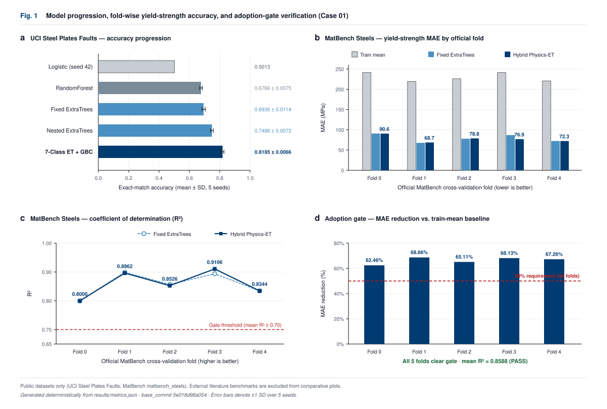
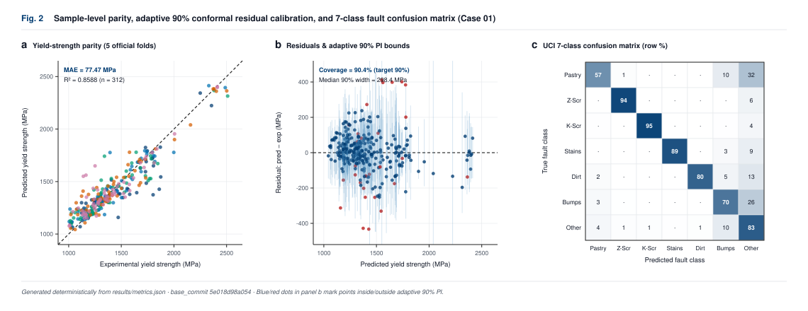

# Case 01 — Predictive Modeling & Diagnostic Results (v0.7.0)

**Summary:** Case 01 evaluates leakage-safe, deterministic ensembles on two open steel benchmarks:
1. **UCI Steel Plates Faults (7-class mutually exclusive):** A soft-voting **ExtraTrees + GradientBoosting** ensemble reaches **0.8185 ± 0.0066** accuracy and **0.8319 ± 0.0119** macro F1 (+6.99 pp accuracy over multi-label Nested ExtraTrees).
2. **MatBench `matbench_steels` (5 official folds):** An inner-CV **Hybrid Composition + Metallurgical-Descriptor ExtraTrees** ensemble reaches **77.4728 ± 7.4580 MPa MAE** and **$R^2 = 0.8588 ± 0.0404$**, with **locally-weighted adaptive 90% cross-conformal prediction intervals** achieving **90.42% ± 5.65%** empirical coverage and **298.37 MPa** median full width (23.3% tighter than constant-width conformal bands).

The adoption gate **passes** on all five folds. This remains a reproducible public-data screening study—not a plant-validated release model.

All three figures are generated deterministically from [`../results/metrics.json`](../results/metrics.json) via `python -m metalkit.cli report` using only the Python standard library.

---

## Reproduced Results (Open Data, Our Computation)

### 1. UCI Steel Plates Faults (5 Stratified 80/20 Seeds)

Verification confirmed that every row in UCI Steel Plates Faults has `sum(labels) == 1` (mutually exclusive 1-of-7 fault classes). Switching from multi-label binary outputs to a 7-class multiclass formulation eliminates invalid zero-fault / multi-fault predictions.

| Model | Formulation | Accuracy | Macro F1 |
|---|---|---:|---:|
| Logistic baseline (seed 42) | Multi-label | 0.5013 | 0.6207 |
| RandomForest (5 seeds) | Multi-label | 0.6766 ± 0.0075 | 0.7526 ± 0.0176 |
| Fixed ExtraTrees (5 seeds) | Multi-label | 0.6936 ± 0.0114 | 0.7755 ± 0.0219 |
| Nested ExtraTrees (5 seeds) | Multi-label | 0.7486 ± 0.0072 | 0.8114 ± 0.0164 |
| 7-Class GradientBoosting (5 seeds) | Single-label 7-class | 0.8026 ± 0.0106 | 0.8170 ± 0.0117 |
| 7-Class ExtraTrees (5 seeds) | Single-label 7-class | 0.8093 ± 0.0075 | 0.8263 ± 0.0156 |
| **7-Class Soft-Voting Ensemble (ET + GBC)** | **Single-label 7-class** | **0.8185 ± 0.0066** | **0.8319 ± 0.0119** |

Per-class confusion diagnostics are visualized in **Fig. 2c** (`c01_diagnostics.svg`).

### 2. MatBench `matbench_steels` (Official 5 Folds)

Target: steel yield strength (MPa). Features combine training-fitted atomic fractions with deterministic metallurgical descriptors (`MetallurgicalDescriptorVectorizer`: composition-weighted elemental statistics + atomic-size mismatch $\delta$, electronegativity spread, mixing entropy $\Delta S_{\text{mix}}/R$, $C_{\text{eq}}$, $\text{Cr}_{\text{eq}}$, $\text{Ni}_{\text{eq}}$). Inner 4-fold CV on each outer training split selects `(max_features, min_samples_leaf, physics_weight)`.

| Fold | Hybrid MAE (MPa) | RMSE (MPa) | $R^2$ | Train-Mean MAE (MPa) | MAE Reduction | Selected Params (`mf, leaf, w_phys`) | Adaptive 90% Coverage | Median 90% Width (MPa) |
|---|---:|---:|---:|---:|---:|---|---:|---:|
| 0 | 90.6403 | 130.7447 | 0.8000 | 241.4591 | 62.46% | `1.0, 1, 0.00` | 79.37% | 242.86 |
| 1 | 68.7470 | 93.1146 | 0.8962 | 219.3770 | 68.66% | `1.0, 2, 0.35` | 92.06% | 269.34 |
| 2 | 78.7737 | 111.6064 | 0.8526 | 225.7932 | 65.11% | `0.5, 1, 0.00` | 91.94% | 332.53 |
| 3 | 76.8826 | 102.1649 | 0.9106 | 241.2035 | 68.13% | `1.0, 2, 0.00` | 95.16% | 356.08 |
| 4 | 72.3206 | 116.1503 | 0.8344 | 220.8898 | 67.26% | `1.0, 1, 0.00` | 93.55% | 291.06 |
| **Mean ± SD** | **77.4728 ± 7.4580** | **110.7562 ± 12.7624** | **0.8588 ± 0.0404** | **229.7445 ± 9.6958** | **66.32% mean** | — | **90.42% ± 5.65%** | **298.37 ± 41.17** |

Comparator scores across the identical 5 official folds:
- **Nested ExtraTrees (atomic fractions only):** MAE **77.6894 ± 7.2132 MPa**, $R^2$ **0.8581 ± 0.0398**
- **Fixed ExtraTrees (500 trees):** MAE **79.1707 ± 8.6980 MPa**, $R^2$ **0.8566 ± 0.0374**
- **RandomForest (300 trees):** MAE **89.6300 ± 7.4424 MPa**, $R^2$ **0.8141 ± 0.0388**
- **GradientBoostingRegressor (metallurgical descriptors):** MAE **92.3263 ± 10.2630 MPa**, $R^2$ **0.7938 ± 0.0754**
- **Ridge (atomic fractions):** MAE **205.3600 ± 11.9359 MPa**, $R^2$ **0.1624 ± 0.0196**

### 3. Adaptive vs. Constant-Width Cross-Conformal 90% Intervals

| Calibration Method | Target Coverage | Empirical Coverage | Mean Full Width (MPa) | Median Full Width (MPa) |
|---|---:|---:|---:|---:|
| Constant-width cross-conformal | 90.0% | 91.98% ± 3.04% | 389.08 ± 30.81 | 389.08 |
| **Adaptive tree-spread cross-conformal** | **90.0%** | **90.42% ± 5.65%** | **343.96 ± 38.45** | **298.37 ± 41.17** |

All calibration residuals are computed strictly from 4-fold out-of-fold predictions on each outer training split; outer test rows never influence the quantile scale.

---

## External Literature Context (Not Reproduced)

| Source | Published Metric | Why It Is Not Our Result |
|---|---|---|
| [MatBench Leaderboard](https://matbench.materialsproject.org/) (Dunn et al., 2020, DOI [10.1038/s41524-020-00406-3](https://doi.org/10.1038/s41524-020-00406-3)) | MODNet v0.1.12, **87.7627 MPa MAE** | Uses a different neural architecture and `matminer` featurization. Our 77.47 MPa is **not** a like-for-like benchmark reproduction. |
| Agrawal et al. (2014), DOI [10.1186/2193-9772-3-8](https://doi.org/10.1186/2193-9772-3-8) | **$R^2 > 0.97$** (~0.98 LOOCV, $n = 437$) | The NIMS steel fatigue dataset is not included in this repository. |
