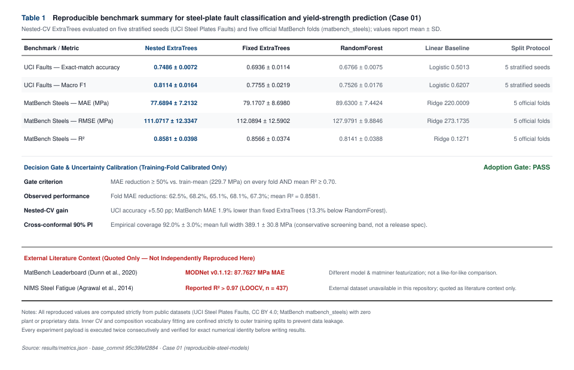

# Case 01 — Predictive Modeling Results

**Summary:** Case 01 evaluates **nested-CV ExtraTrees** models on two open steel datasets. An inner cross-validation loop selects `max_features` and `min_samples_leaf` strictly inside each outer training split; the untouched outer test split provides the reported score. The case-specific adoption gate **passes**. This is a reproducible public-data screening study—not a plant-validated release model and not an independent reproduction of MODNet or Agrawal et al. (2014).

## Case Verdict

| Item | Result |
|---|---|
| Headline model | `ExtraTreesClassifier` / `ExtraTreesRegressor`, `n_estimators=300`, `n_jobs=1`, fixed seeds |
| Nested search | UCI Faults: 3-fold inner CV (macro F1, 4 candidates); MatBench Steels: 4-fold inner CV (negative MAE, 6 candidates) |
| Leakage control | Inner CV and composition vocabulary (`CompositionVectorizer`) are fitted inside each outer training split only |
| Comparators retained | Fixed ExtraTrees (500 trees), RandomForest, Ridge, and Logistic payloads remain in `results/metrics.json` |
| Uncertainty reporting | UCI Faults: 5 fixed seeds; MatBench Steels: 5 official folds (mean ± population SD) |
| Adoption gate | **PASS** — MAE $\ge 50\%$ below train-mean on every official fold **and** mean $R^2 \ge 0.70$ |
| MatBench Steels MAE | **77.6894 ± 7.2132 MPa** vs. train-mean **229.7445 ± 9.6958 MPa** |
| MatBench Steels $R^2$ | **0.8581 ± 0.0398** |
| UCI Faults accuracy | **0.7486 ± 0.0072** (macro F1 **0.8114 ± 0.0164**) |
| Gain vs. fixed ExtraTrees | UCI accuracy **+5.50 pp**; MatBench MAE **1.87% lower** |
| Claim boundary | Public data only. No plant data, no MODNet reproduction, no plant validation. |




Both figures are generated deterministically from [`../results/metrics.json`](../results/metrics.json) via `python -m metalkit.cli report` using only the Python standard library.

---

## Nested Cross-Validation Protocol

1. **Outer split** is never touched during tuning: five stratified 80/20 seeds for UCI Steel Plates Faults, and the five official MatBench folds for `matbench_steels`.
2. **Inner CV** runs strictly on outer training rows: `KFold(shuffle=True)` with 3 folds (UCI Faults) and 4 folds (MatBench Steels) and fixed `random_state`.
3. **Hyperparameter grid** is compact and auditable: `max_features ∈ {0.5, 1.0}` and `min_samples_leaf ∈ {1, 2}` for UCI Faults; `max_features ∈ {0.5, 1.0}` and `min_samples_leaf ∈ {1, 2, 4}` for MatBench Steels.
4. **Selection criterion** uses macro F1 for multi-label UCI Faults and negative MAE for MatBench Steels.
5. **Refit & verification:** The selected configuration is refitted on the full outer training split and scored once on the outer test split. Every experiment payload is executed twice consecutively and must match identically.

For `matbench_steels`, `CompositionVectorizer` is a scikit-learn pipeline step so the element vocabulary is cloned and refitted inside each inner training fold. Neither inner validation nor outer test compositions can alter the feature space. `results/metrics.json` stores `selected_params` and inner best scores for every seed and fold.

---

## Reproduced Results (Open Data, Our Computation)

### 1. UCI Steel Plates Faults

Protocol: 1,941 plates, 27 numeric features, 7 multi-hot fault labels, stratified 80/20 split over five fixed seeds `(42, 7, 11, 19, 23)`.

| Model | Exact-Match Accuracy | Macro F1 | Role |
|---|---:|---:|---|
| Logistic baseline (seed 42) | 0.5013 | 0.6207 | Historical reproducibility baseline |
| RandomForest (5 seeds) | 0.6766 ± 0.0075 | 0.7526 ± 0.0176 | First predictive ensemble |
| Fixed ExtraTrees, 500 trees (5 seeds) | 0.6936 ± 0.0114 | 0.7755 ± 0.0219 | Fixed-hyperparameter comparator |
| **Nested ExtraTrees, 300 trees** | **0.7486 ± 0.0072** | **0.8114 ± 0.0164** | **Headline model** |

Inner CV selects `max_features=1.0` and `min_samples_leaf=1` on every seed (versus scikit-learn's default `max_features="sqrt"` in fixed ExtraTrees). Inner best macro F1 values are `0.7814, 0.8017, 0.7946, 0.7915, 0.7697`.

### 2. MatBench `matbench_steels` (Official 5 Folds)

Target: steel yield strength (MPa). Features: atomic fractions over an element vocabulary fitted strictly on training formulas.

| Fold | Nested MAE (MPa) | RMSE (MPa) | $R^2$ | Train-Mean MAE (MPa) | MAE Reduction | Selected Hyperparameters |
|---|---:|---:|---:|---:|---:|---|
| 0 | 90.6403 | 130.7447 | 0.8000 | 241.4591 | 62.46% | `max_features=1.0, min_samples_leaf=1` |
| 1 | 69.8296 | 94.6921 | 0.8927 | 219.3770 | 68.17% | `max_features=1.0, min_samples_leaf=2` |
| 2 | 78.7737 | 111.6064 | 0.8526 | 225.7932 | 65.11% | `max_features=0.5, min_samples_leaf=1` |
| 3 | 76.8826 | 102.1649 | 0.9106 | 241.2035 | 68.13% | `max_features=1.0, min_samples_leaf=2` |
| 4 | 72.3206 | 116.1503 | 0.8344 | 220.8898 | 67.26% | `max_features=1.0, min_samples_leaf=1` |
| **Mean ± SD** | **77.6894 ± 7.2132** | **111.0717 ± 12.3347** | **0.8581 ± 0.0398** | **229.7445 ± 9.6958** | **66.23% mean** | — |

Comparator scores across the same five official folds:
- **Fixed ExtraTrees:** MAE **79.1707 ± 8.6980 MPa**, $R^2$ **0.8566 ± 0.0374**
- **RandomForest:** MAE **89.6300 ± 7.4424 MPa**, $R^2$ **0.8141 ± 0.0388**
- **Ridge:** MAE **205.3600 ± 11.9359 MPa**, $R^2$ **0.1624 ± 0.0196**

Nested search reduces MAE by **1.87%** vs. fixed ExtraTrees and **13.32%** vs. RandomForest.

### 3. Adoption Gate

> Adopt only if the headline ensemble MAE is at least 50% lower than the train-mean predictor on **every** official fold, and mean $R^2 \ge 0.70$.

Observed fold reductions are **62.46%, 68.17%, 65.11%, 68.13%, 67.26%** with mean $R^2 = \mathbf{0.8581}$. The gate **passes**. This is a case-specific engineering benchmark rule on public data, not an industrial material standard.

### 4. Cross-Conformal Prediction Intervals (`matbench_steels`)

Four-fold out-of-fold absolute residuals are collected strictly from each **outer training split** using the fold's selected hyperparameters. The empirical quantile at $\lceil (n + 1)(1 - \alpha) \rceil / n$ with $\alpha = 0.10$ sets the symmetric half-width. The outer test fold never influences the quantile or width.

| Quantity | Mean ± SD (5 Official Folds) |
|---|---:|
| Empirical coverage (target 90%) | **0.9198 ± 0.0304** |
| Interval half-width | **194.5399 ± 15.4048 MPa** |
| Interval full width | **389.0798 ± 30.8096 MPa** |

Per-fold empirical coverage: `0.8889, 0.9683, 0.9194, 0.9355, 0.8871`. Coverage meets the nominal 90% target on average, while the wide interval reflects the small sample size ($n = 249$ training rows per fold) and composition-only features.

---

## External Literature Context (Not Reproduced)

| Source | Published Metric | Why It Is Not Our Result |
|---|---|---|
| [MatBench Leaderboard](https://matbench.materialsproject.org/) (Dunn et al., 2020, DOI [10.1038/s41524-020-00406-3](https://doi.org/10.1038/s41524-020-00406-3)) | MODNet v0.1.12, **87.7627 MPa MAE** | Uses a different neural architecture and `matminer` featurization. Our 77.6894 MPa is **not** a like-for-like benchmark reproduction. |
| Agrawal et al. (2014), DOI [10.1186/2193-9772-3-8](https://doi.org/10.1186/2193-9772-3-8) | **$R^2 > 0.97$** (~0.98 LOOCV, $n = 437$) | The NIMS steel fatigue dataset is not included in this repository, so the protocol cannot be recomputed. |

---

## Known Limitations

1. **No `matminer` / MODNet reproduction:** External leaderboard scores are cited strictly as context.
2. **No industrial plant data:** Results apply only to the two public benchmarks.
3. **Conservative interval width:** ~389 MPa full width provides calibrated screening uncertainty, not a material release threshold.
4. **Small composition-only dataset ($n = 312$):** Processing history, heat treatment, and microstructure are absent; extrapolation outside the observed alloy space is unsupported.
5. **No physics constraints:** Models are purely statistical, without CALPHAD or thermodynamic priors.

---

## Regenerating Results & Figures

```bash
python -m metalkit.cli reproduce --data-dir data/raw --output-dir results
python -m metalkit.cli report --metrics results/metrics.json
python -m pytest
```
